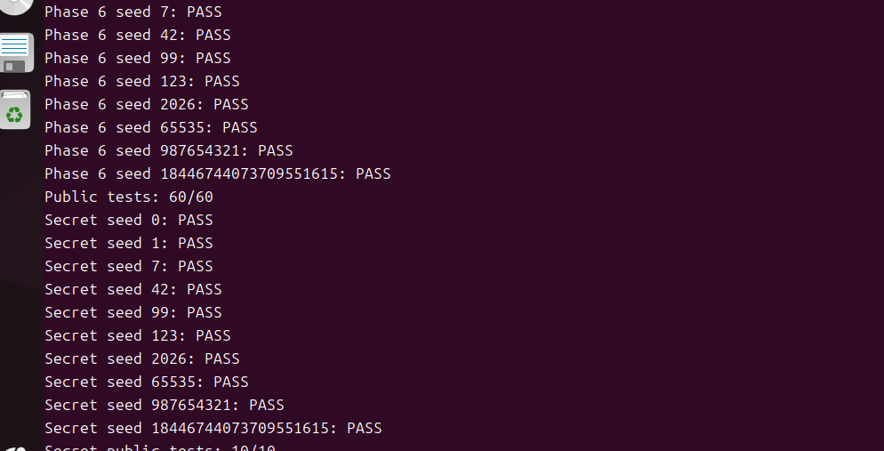
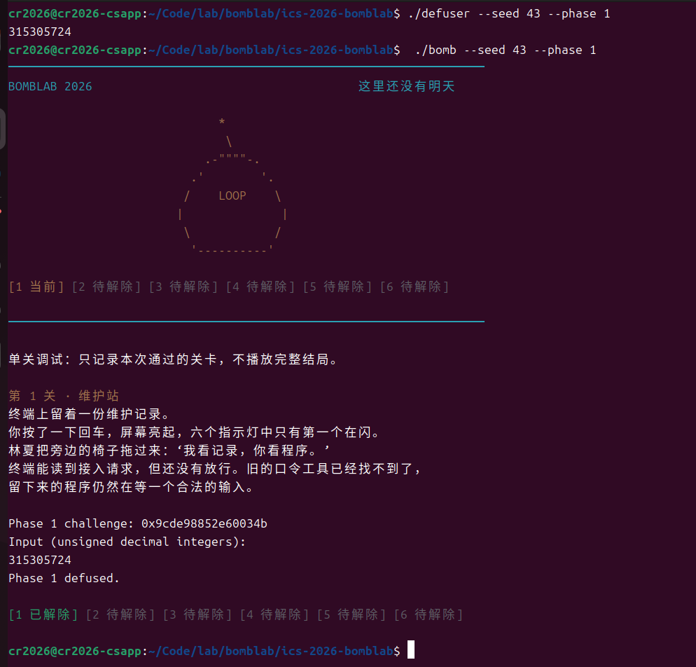
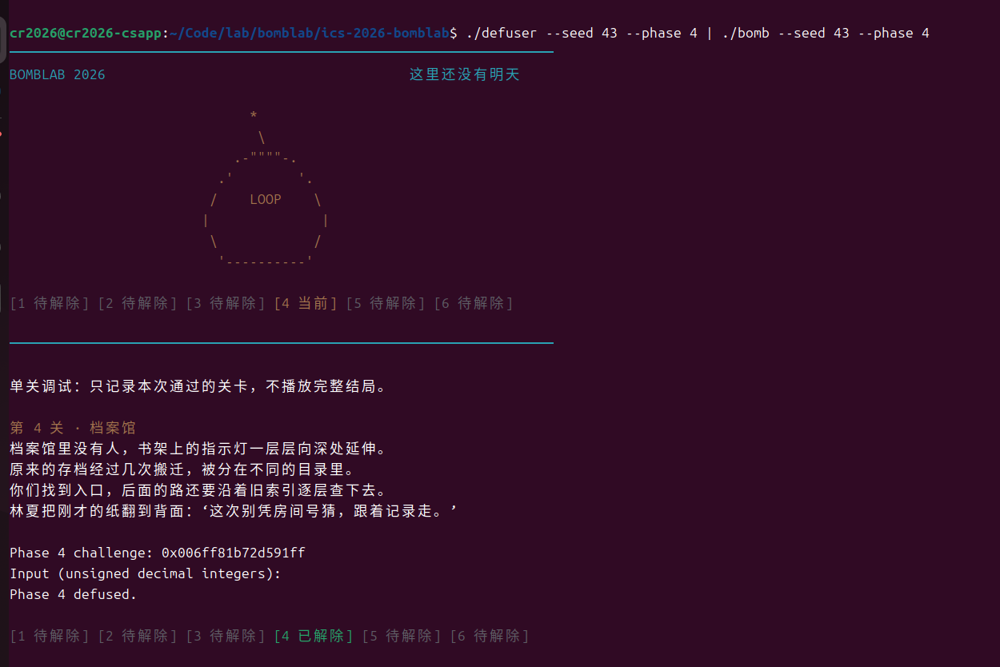
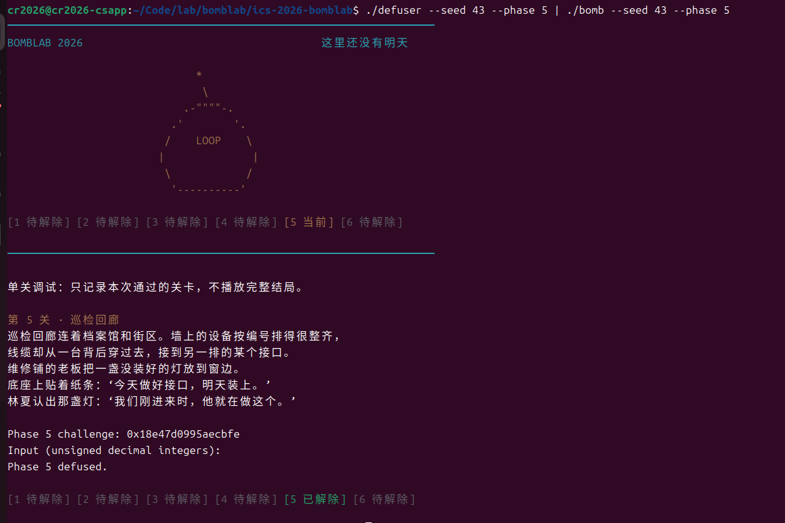
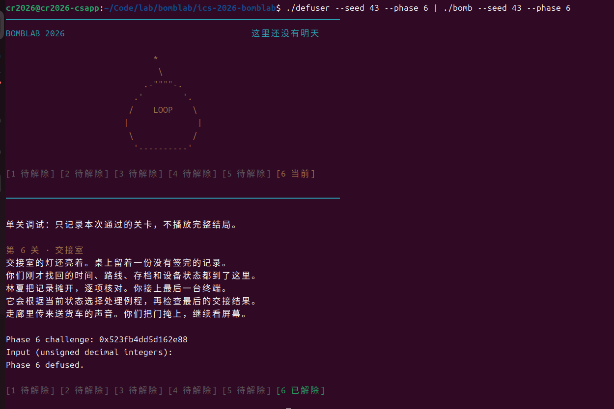
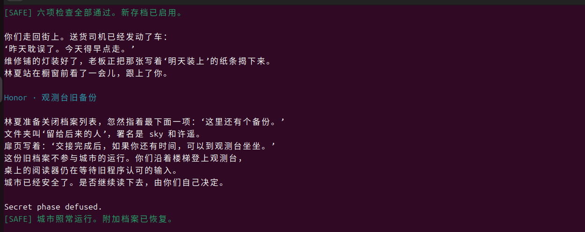

# 实验报告2

## 解题思路

|题目|思路|
|---|---|
|phase_1|沿 `p1_compute` 的实际调用顺序恢复三个 helper，把 challenge 的不同位段代入，得到一个 32 位整数。|
|phase_2|从首项比较恢复初值，再把循环中的索引、移位量、乘法和减法恢复为六项递推。|
|phase_3|由 challenge 得到选择索引及操作数；读取跳转表，按实际索引顺序调用对应 case，输出索引和计算结果。|
|phase_4|恢复二分递归的命中基例、左右子区间和回溯计算，使用相同递归生成结果。|
|phase_5|从访存偏移恢复节点结构，读取静态节点及头指针表，按 challenge 选择起点和步数，输出累计值及最终 tag。|
|phase_6|恢复八项函数指针表和六种操作，按 challenge 提取两个索引，依次计算两次间接调用及中间、末尾变换。|
|Honor|分析局部对象复制布局，构造 32 字节填充、OPEN 标记和三个整数；三个整数由 Honor challenge 与六关口令生成的 context 共同决定。|

## 实现代码+汇编片段

### 1. phase_1

**代码**
```c
int solve_phase_1(uint64_t challenge, char *out, size_t cap) {
    uint32_t values[MAX_FIELDS] = {0};
    size_t count = 0;
    (void)challenge;
    // TODO: 根据 phase_01 的汇编，用 challenge 算出口令中的各个整数，依次存入 values，并把 count 改为整数个数。
    uint32_t low = (uint32_t)challenge;
    uint32_t high = (uint32_t)(challenge >> 32);
    uint32_t a = (high - low) * 3U + UINT32_C(0xfb80);
    uint32_t b = ((uint32_t)(challenge >> 16) + UINT32_C(0x629)) ^ low;
    values[0] = (b + a * 8U) ^ UINT32_C(0x3fce);
    count = 1;
    return write_answer(out, cap, values, count);
}
```
**汇编**

```asm
  402024:	lea    0x629(%rsi),%eax
  40202a:	xor    %edi,%eax
  40202c:	ret
  40202d:	nopl   (%rax)
  402030:	endbr64
  402034:	lea    (%rdi,%rsi,8),%eax
  402037:	xor    $0x3fce,%eax
  40203c:	ret
  40203d:	nopl   (%rax)
  402040:	endbr64
  402044:	sub    %esi,%edi
  402046:	lea    0xfb80(%rdi,%rdi,2),%eax
  40204d:	ret

  402055:	mov    %rdi,%rax
  402058:	mov    %rdi,%rdx
  40205b:	mov    %edi,%esi
  40205d:	shr    $0x20,%rax
  402061:	mov    %edi,%r8d
  402064:	shr    $0x10,%rdx
  402068:	mov    %eax,%edi
  40206a:	mov    %rsp,%rbp
  40206d:	call   402040 <p1_step2>
  402072:	mov    %rdx,%rsi
  402075:	mov    %r8d,%edi
  402078:	mov    %eax,%ecx
  40207a:	call   402020 <p1_step0>
  40207f:	mov    %ecx,%esi
  402081:	mov    %eax,%edi
  402083:	call   402030 <p1_step1>

  4020d8:	mov    %r12,%rdi
  4020db:	call   402050 <p1_compute>
  4020e0:	cmp    %eax,-0x14(%rbp)
  4020e3:	sete   %al
```
**由汇编恢复计算关系**

`p1_compute` 把 challenge 的低 32 位存入 `r8d`，右移 32 位后得到高 32 位，右移 16 位后的值则经 `esi` 参与后续调用。实际调用顺序为 `p1_step2 → p1_step0 → p1_step1`。

- `p1_step2` 中 `sub %esi,%edi` 先计算高位减低位，`lea 0xfb80(%rdi,%rdi,2),%eax` 再计算三倍加常数，得到 `a = 3*(high-low)+0xfb80`。
- `p1_step0` 中 `lea 0x629(%rsi),%eax` 后异或低位，得到 `b = (U32(C>>16)+0x629) ^ low`。
- `p1_step1` 的比例寻址计算 `b+8*a`，再异或 `0x3fce`。
- `phase_01` 把该返回值与输入的唯一整数比较，因此口令是 `(b+8*a)^0x3fce`。

### 2. phase_2

**代码**
```c
int solve_phase_2(uint64_t challenge, char *out, size_t cap) {
    uint32_t values[MAX_FIELDS] = {0};
    size_t count = 0;
    (void)challenge;
    // TODO: 根据 phase_02 的汇编，用 challenge 算出口令中的各个整数，依次存入 values，并把 count 改为整数个数。
    values[0] = ((uint32_t)(challenge >> 15) * 2U & UINT32_C(0x1e)) + 12U;
    for (unsigned i = 1; i < 6; ++i)
        values[i] = (values[i - 1] + i) * 5U
                    - (uint32_t)((challenge >> (9U + 3U * i)) & 63U);
    count = 6;
    return write_answer(out, cap, values, count);
}
```
**汇编**

```asm
  40215a:	mov    %r13,%rdx
  40215d:	mov    -0x40(%rbp),%eax
  402160:	shr    $0xf,%rdx
  402164:	add    %edx,%edx
  402166:	and    $0x1e,%edx
  402169:	add    $0xc,%edx
  40216c:	cmp    %edx,%eax
  40216e:	jne    402115 <phase_02+0x25>
  402170:	mov    $0xc,%ecx
  402175:	mov    $0x1,%edx
  40217a:	mov    %r13,%rdi
  40217d:	add    %edx,%eax
  40217f:	shr    %cl,%rdi
  402182:	lea    (%rax,%rax,4),%eax
  402185:	and    $0x3f,%edi
  402188:	sub    %edi,%eax
  40218a:	mov    %eax,%esi
  40218c:	mov    -0x40(%rbp,%rdx,4),%eax
  402190:	cmp    %esi,%eax
  402192:	jne    402115 <phase_02+0x25>
  402194:	add    $0x1,%rdx
  402198:	add    $0x3,%ecx
  40219b:	cmp    $0x6,%rdx
  40219f:	jne    40217a <phase_02+0x8a>
```
**由汇编恢复计算关系**

`shr $0xf`、`add %edx,%edx`、`and $0x1e`、`add $0xc` 依次给出首项：

```text
v[0] = ((U32(C >> 15) * 2) & 0x1e) + 12
```

循环开始时 `edx=1`，`ecx=12`。`add %edx,%eax` 将下标加到上一项；`lea (%rax,%rax,4),%eax` 乘 5；`shr %cl,%rdi` 后 `and $0x3f` 提取 challenge 的六个位，再从前面的乘积中减去。每轮下标加 1、移位量加 3，直到下标达到 6：

```text
v[i] = 5*(v[i-1]+i) - ((C >> (9+3*i)) & 63), i=1..5
```

减法可能产生无符号回绕，因此输出不能改用有符号十进制。

### 3. phase_3

**代码**
```c
int solve_phase_3(uint64_t challenge, char *out, size_t cap) {
    uint32_t values[MAX_FIELDS] = {0};
    size_t count = 0;
    (void)challenge;
    // TODO: 根据 phase_03 的汇编，用 challenge 算出口令中的各个整数，依次存入 values，并把 count 改为整数个数。
    uint32_t selector = (uint32_t)challenge & 7U;
    uint32_t x = (uint32_t)(challenge >> 3) ^ (uint32_t)(challenge >> 32);
    values[0] = selector;
    switch (selector) {
        case 0: values[1] = (x * 4U) ^ UINT32_C(0x15cf); break;
        case 1: values[1] = (x ^ UINT32_C(0x4729)) + (x >> 2); break;
        case 2: values[1] = x * 5U + UINT32_C(0x19258); break;
        case 3: values[1] = (x ^ UINT32_C(0xe3c2)) + (x >> 1); break;
        case 4: values[1] = x * 3U + UINT32_C(0xdeb5); break;
        case 5: values[1] = x * 5U + UINT32_C(0x6dd); break;
        case 6: values[1] = x * 5U + UINT32_C(0xbe5a); break;
        default: values[1] = (x * 4U) ^ UINT32_C(0x5db); break;
    }
    count = 2;
    return write_answer(out, cap, values, count);
}
```
**汇编**

```asm
  40230c:	mov    %r12d,%edi
  40230f:	xor    %eax,%eax
  402311:	and    $0x7,%edi
  402314:	cmp    %edi,-0x18(%rbp)
  402317:	jne    4022e5 <phase_03+0x25>
  402319:	mov    %r12,%rax
  40231c:	mov    %r12,%rsi
  40231f:	shr    $0x3,%rax
  402323:	shr    $0x20,%rsi
  402327:	xor    %eax,%esi
  402329:	call   402260 <p3_dispatch>
  40232e:	cmp    %eax,-0x14(%rbp)
  402331:	sete   %al

  402264:	mov    %edi,%eax
  402266:	mov    %esi,%edi
  402268:	cmp    $0x7,%eax
  40226b:	ja     4022b5 <p3_dispatch+0x55>
  40226d:	notrack jmp *0x405820(,%rax,8)

  4021d4:	lea    0x0(,%rdi,4),%eax
  4021db:	xor    $0x15cf,%eax
  4021e0:	ret

  402244:	mov    %edi,%eax
  402246:	shr    $0x2,%edi
  402249:	xor    $0x4729,%eax
  40224e:	add    %edi,%eax
  402250:	ret
```
**由汇编恢复计算关系**

`and $0x7,%edi` 和第一个输入比较，说明第一项为 `s=U32(C)&7`。随后分别右移 challenge 3 位和 32 位，再异或得到 `x=U32(C>>3)^U32(C>>32)`。

`jmp *0x405820(,%rax,8)` 按索引读取 8 字节跳转表项。通过 GDB 读取表项并追踪跳转目标，得到下面的实际映射；表项顺序不等于 case 函数编号。

|索引 s|实际函数|第二项|
|---:|---|---|
|0|`p3_case_2`|`(4*x)^0x15cf`|
|1|`p3_case_7`|`(x^0x4729)+(x>>2)`|
|2|`p3_case_0`|`5*x+0x19258`|
|3|`p3_case_3`|`(x^0xe3c2)+(x>>1)`|
|4|`p3_case_1`|`3*x+0xdeb5`|
|5|`p3_case_5`|`5*x+0x6dd`|
|6|`p3_case_6`|`5*x+0xbe5a`|
|7|`p3_case_4`|`(4*x)^0x5db`|

例如 `p3_case_2` 使用比例寻址计算四倍，再异或常数；`p3_case_7` 先保存 x，分别计算异或项和逻辑右移项，最后相加。`phase_03` 将 case 返回值与第二项比较。

### 4. phase_4

**代码**
```c
static uint32_t p4_answer(uint32_t target, uint32_t low, uint32_t high,
                          uint32_t key) {
    uint32_t mid = low + ((high - low) >> 1);
    if (target == mid) return (mid + UINT32_C(0xf6)) ^ key;
    if (target < mid)
        return (p4_answer(target, low, mid - 1U, key) * 3U)
               ^ (mid + key) ^ UINT32_C(0xc);
    return (p4_answer(target, mid + 1U, high, key) * 3U)
           ^ (mid + key) ^ UINT32_C(0x8);
}

int solve_phase_4(uint64_t challenge, char *out, size_t cap) {
    uint32_t values[MAX_FIELDS] = {0};
    size_t count = 0;
    (void)challenge;
    // TODO: 根据 phase_04 的汇编，用 challenge 算出口令中的各个整数，依次存入 values，并把 count 改为整数个数。
    uint32_t key = (uint32_t)(challenge >> 7) ^ (uint32_t)(challenge >> 32);
    values[0] = p4_answer((uint32_t)challenge & 127U, 0, 127U, key);
    count = 1;
    return write_answer(out, cap, values, count);
}
```
**汇编**

```asm
  4023f8:	mov    %r12,%rcx
  4023fb:	mov    %r12,%rax
  4023fe:	mov    %r12d,%edi
  402401:	xor    %esi,%esi
  402403:	shr    $0x20,%rax
  402407:	shr    $0x7,%rcx
  40240b:	and    $0x7f,%edi
  40240e:	mov    $0x7f,%edx
  402413:	xor    %eax,%ecx
  402415:	call   402340 <p4_walk>
  40241a:	cmp    %eax,-0x14(%rbp)
  40241d:	sete   %al

  402344:	mov    %edi,%eax
  402346:	mov    %edx,%edi
  402348:	sub    %esi,%edi
  40234a:	shr    $1,%edi
  40234c:	add    %esi,%edi
  40234e:	cmp    %eax,%edi
  402350:	je     4023a0 <p4_walk+0x60>
  402352:	push   %rbp
  402353:	mov    %rsp,%rbp
  402356:	push   %rbx
  402357:	lea    (%rdi,%rcx,1),%ebx
  40235a:	sub    $0x8,%rsp
  40235e:	cmp    %edi,%eax
  402360:	jb     402380 <p4_walk+0x40>
  402362:	lea    0x1(%rdi),%esi
  402365:	mov    %eax,%edi
  402367:	call   402340 <p4_walk>
  40236c:	lea    (%rax,%rax,2),%eax
  40236f:	xor    %ebx,%eax

  402376:	xor    $0x8,%eax
  402379:	ret
  40237a:	nopw   0x0(%rax,%rax,1)
  402380:	lea    -0x1(%rdi),%edx
  402383:	mov    %eax,%edi
  402385:	call   402340 <p4_walk>
  40238a:	lea    (%rax,%rax,2),%eax
  40238d:	xor    %ebx,%eax
  40238f:	mov    -0x8(%rbp),%rbx
  402393:	leave
  402394:	xor    $0xc,%eax
  402397:	ret

  4023a0:	lea    0xf6(%rdi),%eax
  4023a6:	xor    %ecx,%eax
  4023a8:	ret
```
**由汇编恢复计算关系**

入口从 challenge 提取 `target=U32(C)&127`，令区间为 `[0,127]`，并计算 `key=U32(C>>7)^U32(C>>32)`。

`p4_walk` 中先做 `high-low`，逻辑右移一位后加 low，得到 `mid=low+(high-low)/2`。`cmp` 后的 `je` 是命中中点的基例，返回 `(mid+0xf6)^key`。

`cmp %edi,%eax` 后的 `jb` 表示无符号 target 小于 mid，左区间上界改为 `mid-1`；否则右区间下界改为 `mid+1`。调用前把 `mid+key` 保存到 `ebx`，递归返回后 `lea (%rax,%rax,2),%eax` 将子结果乘 3，再异或保存值。左分支最后异或 `0xc`，右分支最后异或 `0x8`：

```text
F(t,l,h,k):
    m = l + ((h-l)>>1)
    t == m: (m+0xf6) ^ k
    t <  m: (3*F(t,l,m-1,k)) ^ (m+k) ^ 0xc
    t >  m: (3*F(t,m+1,h,k)) ^ (m+k) ^ 0x8
```

保留相同递归结构能直接对应下探和回溯过程；target 保证在区间中，递归会终止。

### 5. phase_5

**代码**
```c
int solve_phase_5(uint64_t challenge, char *out, size_t cap) {
    uint32_t values[MAX_FIELDS] = {0};
    size_t count = 0;
    (void)challenge;
    // TODO: 根据 phase_05 的汇编，用 challenge 算出口令中的各个整数，依次存入 values，并把 count 改为整数个数。
    static const struct {
        uint32_t value;
        uint32_t tag;
        unsigned next;
    } nodes[12] = {
        {0x3690U, 0x735U, 3}, {0x1848U, 0x264U, 7},
        {0x912dU, 0x93fU, 11}, {0x9418U, 0x353U, 2},
        {0xdcb3U, 0x507U, 1}, {0x6161U, 0x621U, 0},
        {0xa85dU, 0xa53U, 4}, {0x13bbU, 0x80fU, 9},
        {0x4208U, 0x52U, 6}, {0xb2eU, 0x442U, 10},
        {0xe6d7U, 0xb66U, 5}, {0x9085U, 0x14aU, 12}
    };
    static const unsigned heads[8] = {8, 6, 4, 1, 7, 9, 10, 5};
    unsigned node = heads[(uint32_t)challenge & 7U];
    unsigned steps = (unsigned)((challenge >> 3) & 3U);
    uint32_t acc = (uint32_t)(challenge >> 6)
                   ^ (uint32_t)(challenge >> 32) ^ UINT32_C(0xbab0);
    for (unsigned i = 0; i <= steps; ++i) {
        acc = (acc ^ nodes[node].value) + nodes[node].tag;
        values[1] = nodes[node].tag;
        if (i < steps) node = nodes[node].next;
    }
    values[0] = acc;
    count = 2;
    return write_answer(out, cap, values, count);
}
```
**汇编**

```asm
  402434:	mov    %rdi,%rax
  402437:	mov    %rdi,%rcx
  40243a:	mov    %rsi,%r8
  40243d:	and    $0x7,%eax
  402440:	shr    $0x3,%rcx
  402444:	mov    0x405b60(,%rax,8),%rdx
  40244c:	mov    %rdi,%rax
  40244f:	shr    $0x20,%rdi
  402453:	shr    $0x6,%rax
  402457:	mov    0x4(%rdx),%esi
  40245a:	xor    %edi,%eax
  40245c:	xor    (%rdx),%eax
  40245e:	mov    %ecx,%edi
  402460:	xor    $0xbab0,%eax
  402465:	mov    %esi,(%r8)
  402468:	add    %esi,%eax
  40246a:	and    $0x3,%edi
  40246d:	je     402489 <p5_traverse+0x59>
  40246f:	mov    $0x1,%ecx
  402474:	mov    0x8(%rdx),%rdx
  402478:	add    $0x1,%ecx
  40247b:	mov    0x4(%rdx),%esi
  40247e:	xor    (%rdx),%eax
  402480:	add    %esi,%eax
  402482:	mov    %esi,(%r8)
  402485:	cmp    %ecx,%edi
  402487:	jae    402474 <p5_traverse+0x44>
  402489:	ret

  4024dc:	lea    -0x14(%rbp),%rsi
  4024e0:	mov    %r12,%rdi
  4024e3:	call   402430 <p5_traverse>
  4024e8:	mov    %eax,%edx
  4024ea:	xor    %eax,%eax
  4024ec:	cmp    %edx,-0x1c(%rbp)
  4024ef:	jne    4024b5 <phase_05+0x25>
  4024f1:	mov    -0x14(%rbp),%eax
  4024f4:	cmp    %eax,-0x18(%rbp)
  4024f7:	sete   %al
```
**由汇编恢复计算关系**

`(%rdx)`、`0x4(%rdx)` 和 `0x8(%rdx)` 分别被当作 4 字节 value、4 字节 tag 和 8 字节 next 指针，节点总长 16 字节。读取 `p5_nodes` 和 `p5_heads` 后，将地址换算为节点下标，得到代码中的静态节点表与头下标表。NULL 用下标 12 表示；本题规定的起点与步数不会访问该下标。

`and $7` 选择头指针；`C>>3` 的低两位决定沿 next 前进的次数 `steps`。初始累计值为：

```text
acc = U32(C>>6) ^ U32(C>>32) ^ 0xbab0
```

函数在进入循环前已经处理头节点，执行 `acc=(acc^value)+tag`，并把 tag 写入输出指针。循环每次先取 next，再重复该计算。因此总处理节点数为 `steps+1`，而不是 steps。

入口先比较 `p5_traverse` 返回值，再比较通过指针写回的最后 tag，所以两个输出的顺序为 `acc last_tag`。实现只保存从二进制恢复出的静态常量，运行时不读取炸弹文件或内存。

### 6. phase_6

**代码**
```c
static uint32_t ror32(uint32_t x, unsigned n) {
    return (x >> n) | (x << (32U - n));
}

static uint32_t p6_apply(unsigned slot, uint32_t x) {
    static const unsigned operations[8] = {4, 0, 1, 0, 2, 3, 4, 5};
    switch (operations[slot]) {
        case 0: return (x ^ UINT32_C(0x2446)) + (x << 7);
        case 1: return (x + UINT32_C(0xc9b9)) ^ (x >> 5);
        case 2: return ror32(x, 2);
        case 3: return ((x << 3) + UINT32_C(0x31c7)) ^ (x * 7U);
        case 4: return ((x >> 1) ^ x) + UINT32_C(0x909c);
        default: return ror32(x, 27) ^ UINT32_C(0x49b);
    }
}

int solve_phase_6(uint64_t challenge, char *out, size_t cap) {
    uint32_t values[MAX_FIELDS] = {0};
    size_t count = 0;
    (void)challenge;
    // TODO: 根据 phase_06 的汇编，用 challenge 算出口令中的各个整数，依次存入 values，并把 count 改为整数个数。
    uint32_t x = (uint32_t)(challenge >> 6) ^ (uint32_t)(challenge >> 32);
    unsigned first = (unsigned)(challenge & 7U);
    unsigned second = (unsigned)((challenge >> 3) & 7U);
    x = p6_apply(first, x) ^ UINT32_C(0x26f5);
    values[0] = p6_apply(second, x) + UINT32_C(0x9ca2);
    count = 1;
    return write_answer(out, cap, values, count);
}
```
**汇编**

```asm
  402589:	mov    %rdi,%rbx
  40258c:	shr    $0x6,%rdi
  402590:	mov    %rbx,%rax
  402593:	shr    $0x20,%rax
  402597:	xor    %eax,%edi
  402599:	mov    %rbx,%rax
  40259c:	sub    $0x8,%rsp
  4025a0:	and    $0x38,%ebx
  4025a3:	and    $0x7,%eax
  4025a6:	call   *0x405e00(,%rax,8)
  4025ad:	xor    $0x26f5,%eax
  4025b2:	mov    %eax,%edi
  4025b4:	call   *0x405e00(%rbx)
  4025ba:	mov    -0x8(%rbp),%rbx
  4025be:	leave
  4025bf:	add    $0x9ca2,%eax
  4025c4:	ret

  402534:	mov    %edi,%eax
  402536:	ror    $0x2,%eax
  402539:	ret

  402574:	mov    %edi,%eax
  402576:	rol    $0x5,%eax
  402579:	xor    $0x49b,%eax
  40257e:	ret
```
**由汇编恢复计算关系**

`shr $6` 后与 challenge 高 32 位异或得到初始操作数 `x`。第一次间接调用使用 `C&7` 作为表下标。第二次调用前的 `and $0x38,%ebx` 保留第 3～5 位，得到的是字节偏移，除以每项 8 字节后，其下标是 `(C>>3)&7`。

GDB 读取函数指针表得到实际映射 `[4,0,1,0,2,3,4,5]`，其中数字表示 `p6_op_*` 后缀，重复表项也必须保留。六个函数对应：

|操作|计算关系|
|---:|---|
|0|`(x^0x2446)+(x<<7)`|
|1|`(x+0xc9b9)^(x>>5)`|
|2|`ROR32(x,2)`|
|3|`((x<<3)+0x31c7)^(7*x)`|
|4|`((x>>1)^x)+0x909c`|
|5|`ROL32(x,5)^0x49b`|

第一次调用后先异或 `0x26f5`，再把返回值作为第二次调用的参数，最后加 `0x9ca2`。`ror` 和 `rol` 都是 32 位循环移位；代码使用右旋 27 位等价实现左旋 5 位。

### 7. Honor

**代码**

使用 phase_6 中的 `ror32` 辅助函数。

```c
int solve_secret(uint64_t challenge, uint64_t context, char *out, size_t cap) {
    (void)challenge;
    (void)context;
    (void)out;
    (void)cap;
    // TODO（选做）: 根据 secret_gate、secret_copy 和 secret_phase 的汇编构造完整的第七行，写入 out 后返回 0。
    // 第七行不一定只有整数，可以直接用 snprintf 写入；还没完成时保持返回 1，测试会显示 not attempted。
    uint32_t a = (uint32_t)challenge ^ (uint32_t)(challenge >> 32);
    uint32_t b = (uint32_t)context ^ (uint32_t)(context >> 32);
    uint32_t selector = (uint32_t)context & 3U;
    uint32_t second = ror32(a ^ b, 1) ^ UINT32_C(0x6b34)
                      ^ (selector * UINT32_C(0x7720)) ^ (uint32_t)(context >> 16);
    uint32_t third = second ^ (b + selector + UINT32_C(0x1c14) + (a >> 1));
    int size = snprintf(out, cap,
                        "AAAAAAAAAAAAAAAAAAAAAAAAAAAAAAAAOPEN%" PRIu32 " %" PRIu32 " %" PRIu32,
                        selector, second, third);
    return size < 0 || (size_t)size >= cap;

}
```
**汇编**

```asm
  40273b:	lea    -0xd0(%rbp),%r12

  402759:	mov    %rbx,%rdi
  40275c:	call   401190 <strlen@plt>
  402761:	sub    $0x24,%rax
  402765:	cmp    $0x7f,%rax
  402769:	jbe    402780 <secret_gate+0x60>

  402780:	mov    %rbx,%rsi
  402783:	mov    %r12,%rdi
  402786:	call   402700 <secret_copy>
  40278b:	cmpl   $0x4e45504f,-0xb0(%rbp)
  402795:	jne    40276b <secret_gate+0x4b>
  402797:	mov    %r14,%rdx
  40279a:	mov    %r13,%rsi
  40279d:	lea    -0xac(%rbp),%rdi
  4027a4:	call   402640 <secret_phase>

  402710:	movzbl (%rsi,%rax,1),%edx
  402714:	mov    %dl,(%rdi,%rax,1)
  402717:	add    $0x1,%rax
  40271b:	test   %dl,%dl
  40271d:	jne    402710 <secret_copy+0x10>
  40271f:	ret

  4026a0:	mov    %r13d,%ecx
  4026a3:	xor    %edx,%edx
  4026a5:	and    $0x3,%ecx
  4026a8:	cmp    %ecx,-0x2c(%rbp)
  4026ab:	jne    40266a <secret_phase+0x2a>
  4026ad:	mov    %r12,%rsi
  4026b0:	imul   $0x7720,%ecx,%r9d
  4026b7:	mov    %r13,%r8
  4026ba:	shr    $0x20,%rsi
  4026be:	shr    $0x20,%r8
  4026c2:	xor    %r12d,%esi
  4026c5:	xor    %r13d,%r8d
  4026c8:	shr    $0x10,%r13
  4026cc:	mov    %esi,%edi
  4026ce:	xor    %r13d,%r9d
  4026d1:	xor    %r8d,%edi
  4026d4:	call   402630 <secret_mix>
  4026d9:	xor    %r9d,%eax
  4026dc:	cmp    %eax,-0x28(%rbp)
  4026df:	jne    40266a <secret_phase+0x2a>
  4026e1:	shr    $1,%esi
  4026e3:	lea    0x1c14(%r8,%rcx,1),%edx
  4026eb:	add    %esi,%edx
  4026ed:	xor    %edx,%eax
  4026ef:	cmp    -0x24(%rbp),%eax
  4026f2:	sete   %dl

  402634:	mov    %edi,%eax
  402636:	ror    $1,%eax
  402638:	xor    $0x6b34,%eax
  40263d:	ret
```
**由汇编恢复布局和计算关系**

`secret_gate` 以 `rbp-0xd0` 为复制起点。长度减去 `0x24` 后按无符号比较不超过 `0x7f`，等价于要求原字符串长度在 `[36,163]`。`secret_copy` 逐字节复制直到并包括 `\00`。

复制后的标记位于 `rbp-0xb0`，与起点相距 `0x20=32` 字节，比较常量为 `0x4e45504f`。x86-64 为小端序，对应连续 ASCII 字节 `4f 50 45 4e`，即 `OPEN`。后续传给 `secret_phase` 的地址是 `rbp-0xac`，与起点相距 36 字节，所以构造：

```text
偏移 0..31：32 个 A
偏移 32..35：OPEN
偏移 36 起：三个空格分隔的无符号整数
末尾：字符串结束符
```

此构造只利用实验要求的局部字段覆盖，不覆盖返回地址。

令 `T=context`，由 `secret_phase` 恢复：

```text
a = U32(C) ^ U32(C>>32)
b = U32(T) ^ U32(T>>32)
s = U32(T) & 3
y = ROR32(a^b,1) ^ 0x6b34 ^ (s*0x7720) ^ U32(T>>16)
z = y ^ (b+s+0x1c14+(a>>1))
```

`and $3` 与第一个整数比较，确定 s；`secret_mix` 右旋 1 位后异或 `0x6b34`，返回值再与 context 派生项异或，得到第二项 y；后续加法和异或得到第三项 z。

context 由公共驱动根据前六关口令生成，求解函数直接使用传入值。最终第七行为 `32个A + OPEN + s y z`，无需在 OPEN 与第一个数字之间额外加空格。

## 本地测试

```bash
# 实验目录下执行
make
make test
```

```text
Public tests: 60/60
Secret public tests: 10/10
```

- 非公开 seed 验证  `--seed 43`

### phase_1

```bash
./defuser --seed 43 --phase 1 | ./bomb --seed 43 --phase 1
```


### phase_2

```bash
./defuser --seed 43 --phase 2 | ./bomb --seed 43 --phase 2
```


### phase_3

```bash
./defuser --seed 43 --phase 3 | ./bomb --seed 43 --phase 3
```


### phase_4

```bash
./defuser --seed 43 --phase 4 | ./bomb --seed 43 --phase 4
```



### phase_5

```bash
./defuser --seed 43 --phase 5 | ./bomb --seed 43 --phase 5

 

### phase_6

```bash
./defuser --seed 43 --phase 6 | ./bomb --seed 43 --phase 6
```



### Honor

<!--  -->


